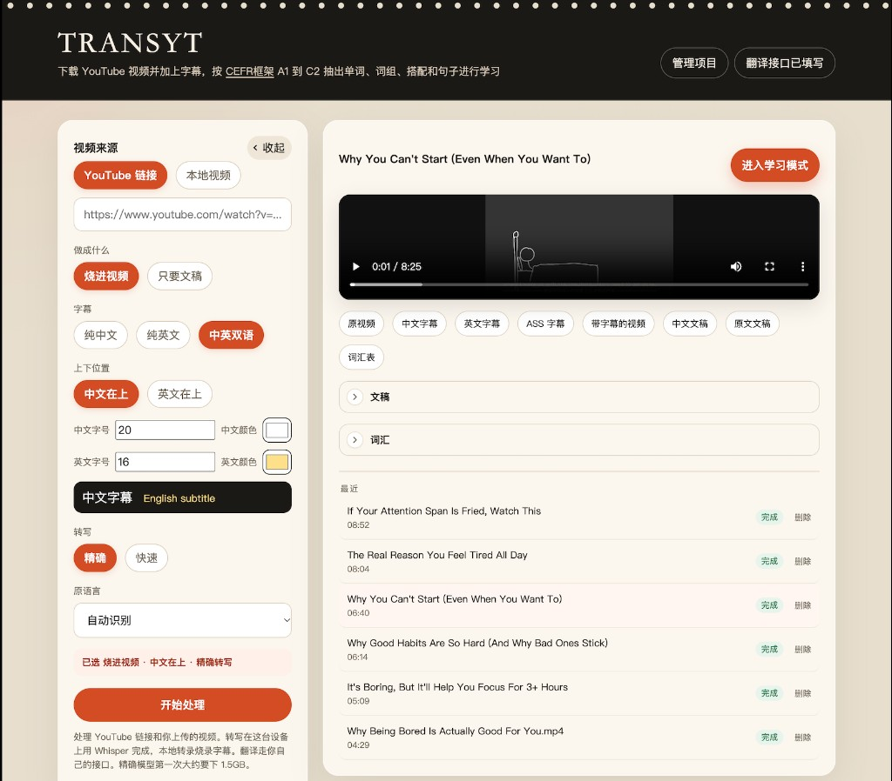
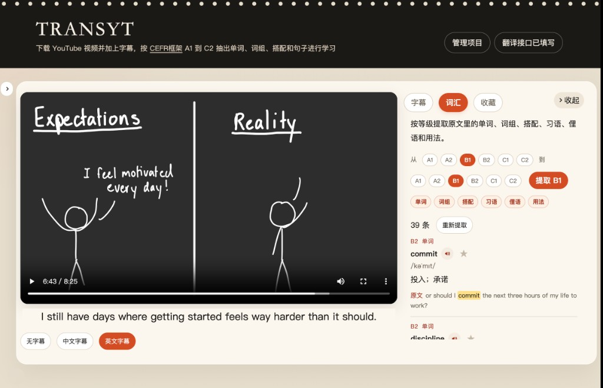
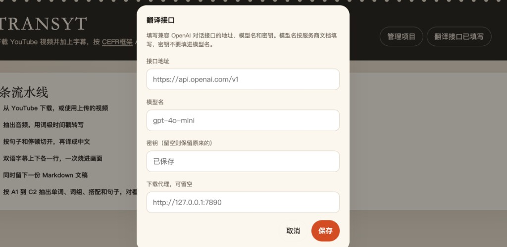

#  Transyt

[English](README.md)

在自己的电脑上，把 YouTube 视频或本地视频转成带字幕的成片，并留下中英文字幕、文稿和词汇，方便对着画面学英语。

转写在本机用 Whisper 完成，音频不会发到别处。翻译走你自己填写的接口。任务、视频和密钥都留在本机的 `data/` 目录。
## 能做什么

- 下载 YouTube 视频，或上传本地视频（mp4、mov、mkv、webm、m4v，最大 2GB）
- 抽出音频，按词级时间戳转写，再按句子和停顿切开
- 把原文译成中文。字幕可以是纯中文、纯英文，或中英双语
- 双语时可选中文在上或英文在上。中文、英文各占一行，字号和颜色分开设置
- 把字幕烧进画面，或只生成文稿
- 学习模式里对着画面看字幕、抽词汇、收藏句子和词
- 用收藏夹管理项目，按标题搜索旧视频

一次只处理一个任务。后面提交的会排队。开发服务或生产进程重启后，正在跑的任务会变成中断；转写已经写出 `cues.json` 的，可以继续翻译和烧录。

## 一次处理会经过什么

1. **下载或导入。** YouTube 用 `yt-dlp` 下载。本地视频直接保存。需要代理时，使用「翻译接口」里填写的下载代理。
2. **提取音频。** 用 ffmpeg 抽出音轨，供转写使用。
3. **转写。** 本机 Whisper 生成带时间戳的原文。精确模型第一次大约下载 1.5GB，快速模型更小。原语言可选自动识别、英语、日语、韩语、法语、西班牙语、德语、中文。
4. **翻译。** 非中文视频会把每一条字幕译成中文，每批 12 句，最多 3 路同时请求你的接口。检测到中文时跳过翻译，原文直接当作中文。选了纯英文但原片是中文时，没有英文可烧，会改回纯中文。
5. **烧录。** 选择「烧进视频」且素材有画面时，用带 libass 的 ffmpeg 把字幕烧进成片。选择「只要文稿」，或素材没有画面时，跳过这一步。
6. **文稿。** 写出中文 Markdown。原文不是中文时，另外留下原文文稿。

中文译文会去掉句末标点，并尽量保持一行。双语字幕上下各一行，时间轴相同。

## 界面

首页左侧是处理表单，右侧是当前任务、下载项和最近列表。点左上角 **TRANSYT** 会回到首页并清空这次的表单选项。已保存的翻译接口和密钥不会被清掉。




### 字幕样式

| 选项 | 烧进画面的内容 | 字号和颜色 |
| --- | --- | --- |
| 纯中文 | 只烧中文 | 只显示中文字号、中文颜色 |
| 纯英文 | 只烧英文原文 | 只显示英文字号、英文颜色 |
| 中英双语 | 中英文各一行 | 中英两套都显示，并可选择谁在上面 |

默认中文字号 20、白色，英文字号 16、淡黄。字号范围是 12 到 64。这些样式会记在本机设置里，下次打开仍然有效。

### 学习模式

处理完成后，有视频就可以进入学习模式。画面留在左边，右边是字幕、词汇、收藏。



- **字幕：** 点一行会跳到对应时间。旁边的星标收藏这句话。
- **词汇：** 先选 A1 到 C2 的等级范围，以及单词、词组、搭配、习语、俚语、用法，再提取。提取结果带中文释义和音标。等级范围内没有的内容会留空，不会拿更简单的词来凑。点单词跳到对应时间，小喇叭用系统语音朗读，点原文句子会译成中文。
- **收藏：** 这个视频里收藏过的句子和词。

朗读使用浏览器的系统语音，单词不会上传。Mac 上的本地语音可以离线使用。

「管理项目」里的「我的学习收藏」汇总所有视频收藏过的句子和词。点一条会打开对应视频的学习模式。

### 管理项目

- **项目：** 按收藏夹筛选，并用标题搜索。搜索和当前收藏夹同时生效。
- **收藏夹：** 可以新建、删除。删除收藏夹后，里面的项目回到未分类。
- 打开一条项目会回到首页。删除项目时，会同时删掉下载的视频和字幕。同一条 YouTube 视频如果处理过多次，删除时会一起去掉。

## 环境

### 一键安装之外，要自己准备

这些不会被页面按钮装上：

| 要准备的 | 说明 |
| --- | --- |
| Node.js 18.18 或更新 | 用来 `npm install`、`npm run dev` |
| Python 3.9 或更新 | 终端里能调用 `python3` 或 `python`。建议 3.11 或 3.12。按钮只用它在项目里建虚拟环境，不会替你装 Python |
| 翻译接口 | 右上角自己填地址、模型名和密钥 |
| 系统字体 | 烧字幕时，Mac 用苹方，Windows 用微软雅黑 |
| Windows 的 VC++ 运行库 | 没有的话，`faster-whisper` 可能装好了但加载失败。安装 [Microsoft Visual C++ 2015–2022 Redistributable（x64）](https://learn.microsoft.com/en-us/cpp/windows/latest-supported-vc-redist) |
| Linux，或非 64 位 Windows 上的 ffmpeg | 这些系统没有现成下载包，要自己装带 libass 的 ffmpeg |

第一次转写时还会下载 Whisper 模型（精确模型大约 1.5GB），放进 `data/models`。这是跑任务时发生的，不是点安装按钮时下载。

Windows 从 [python.org](https://www.python.org/downloads/) 安装时，勾选 **Add python.exe to PATH**。不要把 Mac 上的 `node_modules` 拷到 Windows，换系统后在项目目录重新执行 `npm install`。暂停任务时，Windows 会用 `taskkill` 结束转写或烧录进程。

### 一键安装会装的

打开页面后，缺的工具列在顶部。点 **一键安装**，缺什么装什么，都放进项目的 `data/`，不动系统 Python：

| 路径 | 装什么 |
| --- | --- |
| `data/venv` | `faster-whisper` 和 `yt-dlp`。苹果芯片还会尝试 `mlx-whisper`，失败就继续用 `faster-whisper` |
| `data/bin` | 带 libass 的 ffmpeg 和 ffprobe，适用于 Mac 和 64 位 Windows |

Python 包装进项目虚拟环境，不会碰到 Homebrew 的 PEP 668 报错。已经有的不会重装。项目里有一份就用项目里的，没有再用 PATH 里的命令。

| 命令 | 用途 |
| --- | --- |
| `ffmpeg`、`ffprobe` | 抽音频、烧字幕。ffmpeg 需要带 libass |
| `yt-dlp` | 下载 YouTube |
| `python3` 或 `python` | 建项目环境、跑转写 |

横幅下的日志会显示正在装什么。失败时页面保留原因和重试按钮。常见原因是没装 Python、版本太旧、连不上软件源、磁盘不够，或 Windows 缺少 VC++ 运行库。

### 想自己装也可以

不使用页面按钮时，转写库二选一。已经安装 MLX 时优先用它：

| 系统 | 库 | 精确模型 | 快速模型 |
| --- | --- | --- | --- |
| 苹果芯片 Mac | `mlx-whisper` | `mlx-community/whisper-large-v3-turbo` | `mlx-community/whisper-medium-mlx` |
| Windows，以及其他没有 MLX 的电脑 | `faster-whisper` | `large-v3-turbo` | `medium` |

两套模型文件不能共用。换电脑或换引擎会重新下载。

Mac：

```bash
brew install ffmpeg yt-dlp
pip3 install mlx-whisper
```

Windows，工具放进 PATH：

```bash
pip install faster-whisper yt-dlp
```

## 下载并启动

```bash
git clone https://github.com/knowledgefxg/Transyt.git
cd Transyt
npm install
npm run dev
```

也可以在 GitHub 仓库页面下载 ZIP。

浏览器打开 [http://localhost:3000](http://localhost:3000)。

下载项目和启动开发服务要自己做。页面顶部若提示缺少 ffmpeg、yt-dlp 或 Whisper，再点 **一键安装**。

构建后用生产模式运行：

```bash
npm run build
npm start
```

## 翻译接口

右上角「翻译接口」保存的是字幕翻译和词汇提取共用的一套配置，写在 `data/settings.json`。程序不绑定某一家服务商，只要对方提供兼容 OpenAI Chat Completions 的接口即可。官方接口、中转站、本机部署的兼容服务都可以。



请求使用 `POST`，请求头是 `Authorization: Bearer <密钥>`，正文里带 `model`、`temperature: 0.2` 和 `messages`。字幕翻译要求模型只返回 JSON，每一条对应一句原文。词汇提取用同一次配置，从原文里挑出单词、词组、搭配、习语、俚语和用法。

### 四项怎么填

| 项 | 怎么填 |
| --- | --- |
| 接口地址 | 服务商文档里的 API 根地址，通常以 `/v1` 结尾，例如 `https://api.openai.com/v1`。程序会在末尾补上 `/chat/completions`。如果文档给出的已经是完整的 `.../chat/completions`，就原样填写，不会再补一次 |
| 模型名 | 该地址下实际可用的模型 ID，按服务商文档填写，例如 `gpt-4o-mini`、`deepseek-chat`、`qwen-plus`。不要把密钥填在这里 |
| 密钥 | 服务商发放的 API Key。已保存过之后，输入框留空再点保存，会保留原来的密钥，页面也不会把密钥显示回来。如果误把 `sk-` 开头的密钥填进了模型名，保存时会把它挪到密钥栏；接口地址里含有 DeepSeek 时，模型名会改成 `deepseek-chat`，否则改成 `gpt-4o-mini` |
| 下载代理 | 只给 YouTube 下载用，可留空。翻译请求不走这个代理。需要时填 `http://127.0.0.1:7890` 这类地址 |

地址、模型名、密钥要能配成一次成功的对话请求。换服务商时，这三项通常一起改。只改模型名、沿用旧地址，往往会返回 404 或模型不存在。

还没填密钥就提交任务时，转写结果会先保存。补上密钥后，可以继续翻译和烧录。学习模式里提取词汇同样依赖这套配置。

下面只是常见写法，不是支持列表。以你所用服务的文档为准：

| 服务 | 接口地址 | 模型名示例 |
| --- | --- | --- |
| OpenAI | `https://api.openai.com/v1` | `gpt-4o-mini` |
| DeepSeek | `https://api.deepseek.com/v1` | `deepseek-chat` |
| 通义千问（兼容模式） | `https://dashscope.aliyuncs.com/compatible-mode/v1` | `qwen-plus` |
| 本机或中转 | 文档给出的根地址 | 该服务列出的模型 ID |

## 处理结果

每个任务保存在 `data/jobs/<编号>/`。编号是 16 位十六进制。常见文件：

| 文件 | 内容 |
| --- | --- |
| `video.mp4` | 下载或导入后的原视频 |
| `burned.mp4` | 烧进字幕的成片 |
| `zh.srt` | 中文字幕 |
| `en.srt` | 英文字幕。原文不是中文时生成，时间轴与中文字幕一致 |
| `subs.ass` | 实际拿去烧录的字幕 |
| `source.srt` | 转写得到的原文时间轴 |
| `transcript-zh.md` | 中文文稿 |
| `transcript-src.md` | 原文文稿。原文不是中文时生成 |
| `lexicon.json` | 按等级抽出的词汇。在学习模式里提取后才有 |
| `cues.json` | 断句和时间轴。有这个文件就可以从翻译接着做 |
| `job.json` | 这条任务的状态、选项和阶段 |

首页和项目管理里可以下载成片、字幕和文稿。

## 暂停、失败和接着做

处理过程中可以暂停。暂停会停掉当前的下载、转写或烧录进程。

翻译中途失败，或服务重启导致中断时，如果转写已经完成，页面上会出现「继续翻译和烧录」。它会沿用已经写好的译文，缺的部分再请求接口。

正在处理的项目不能删除，要等它结束或暂停之后再删。

## 开发

断句检查：

```bash
npm run test:segment
```
